# **PROJECT PROPOSAL**

## **1. Project Title**

**Gayn Kotor: A Decentralized Campus Knowledge Exchange and Peer Learning Platform with Micro-Credit Ledger and Verified Course Streaming**

---

## **2. Introduction / Background**

Higher education institutions generate immense volumes of academic knowledge daily through lecture notes, lab guides, exam preparations, and practical implementations. However, in contemporary university campuses, the sharing and curation of this intellectual capital remain largely fragmented, informal, and unverified. Students typically resort to ephemeral messaging channels (e.g., WhatsApp, Messenger, Telegram) or cloud storage links (e.g., Google Drive) to distribute study materials. 

These informal approaches suffer from severe structural drawbacks:
- Study materials are disorganized, unindexed, and difficult to search across departmental semesters.
- Quality control is non-existent; erroneous, plagiarized, or outdated materials circulate without peer or faculty oversight.
- Students who invest substantial effort into authoring high-quality notes have no tangible incentive or institutional recognition.
- Peer tutoring and academic mentoring are ad-hoc, suffering from frequent scheduling friction, unreliability, and student no-shows.
- Student creators who prepare structured educational video courses lack a safe, campus-centric monetization and streaming outlet.

**Gayn Kotor** addresses these systemic challenges by establishing an integrated, institutional web platform that combines decentralized peer-faculty note curation, a gamified micro-credit economy (**Nut Hollow**), an escrow-backed peer skill swap service, and a video course marketplace with secure HTTP Range streaming.

---

## **3. Problem Statement**

University students face substantial friction in acquiring verified academic resources and finding reliable peer mentors. The key problems identified in the current campus ecosystem include:

- **Lack of Verification and Quality Assurance**: Students lack a mechanism to verify whether notes circulating online align with the official departmental syllabus or contain critical technical errors.
- **Academic Free-Rider Problem**: A tiny fraction of diligent students create notes, while the broader student body consumes them without reciprocity, creating contributor burnout.
- **No-Show and Commitment Friction in Peer Mentoring**: Informal peer tutoring arrangements frequently fail because neither party has a binding commitment or incentive to show up on time.
- **Digital Piracy and Unprotected Media Distribution**: Lecture slides and student-authored video courses shared on open drives are easily scraped, pirated, or distributed without authorization.
- **Fragmented Campus Identity**: Academic collaborations across diverse batches and departments lack a centralized directory respecting campus hierarchies (Depts, Batches, Class Representatives, Class Teachers).

---

## **4. Objectives**

### **4.1 General Objective**
To design, architect, and implement a scalable, secure, and user-friendly web-based campus knowledge exchange platform that fosters verified peer learning through a gamified micro-credit ledger, an escrow-backed tutoring scheduler, and an authorized video streaming marketplace.

### **4.2 Specific Objectives**
- To implement strict academic identity verification requiring valid 15-to-17 digit university student identification numbers and institutional email validation.
- To model a multi-tiered departmental and batch hierarchy supporting Class Representatives (CRs) and faculty Class Teachers.
- To design a decentralized note review and moderation workflow with automated reminder escalation and community flag management.
- To implement **Nut Hollow**, an append-only, immutable micro-credit financial ledger providing double-spend protection through row-level locking (`SELECT ... FOR UPDATE`).
- To engineer a peer skill-swapping escrow mechanism with automated deposit locks, meeting link validation, and no-show dispute resolution.
- To build a video course marketplace featuring billable duration validation via audio/video metadata analysis, instructor revenue sharing, and RFC 7233-compliant HTTP Range partial streaming.
- To evaluate the system through automated security test suites, performance optimization (per-request caching, query indexing), and deployment readiness checks.

---

## **5. Scope of the Project**

### **5.1 Focus Areas**
- **User Authentication and Verification**: Institutional registration, student ID constraints, cryptographic email verification tokens, and role-based permissions (Student, Lecturer, Staff, Superuser).
- **Campus Academic Structure**: Departmental catalogs, batch creation, class teacher assignment, and CR promotion.
- **Academic Notes Module**: Multi-format PDF upload, automatic cover-page rasterization (PyMuPDF), private storage isolation, preview rendering, and unlock mechanics.
- **Moderation Workflow**: Review queues, CR reminders (Day 2), faculty escalation (Day 4), auto-publishing fallbacks (Day 7), reporting, and appeals.
- **Nut Hollow Credit Ledger**: Double-entry ledger architecture, sign-up bonuses, upload rewards, unlock deductions, rating incentives, and administrative adjustments.
- **Peer Skill Swap Exchange**: Offer/request skill listings, session booking, Google Meet/Zoom URL validation, 10-nut deposit escrow, and automated dispute resolution.
- **Video Courses & Streaming**: Course management, pricing boundary enforcement, lesson playlists, HTTP 206 Partial Content video streaming, and instructor wallet payouts.
- **Reporting & Notifications**: In-app notifications, activity tracking, and comprehensive administrative audit controls.

### **5.2 Limitations**
- Video transcoding is performed client-side or during upload without an external distributed video transcoding cluster (e.g., FFmpeg cluster).
- Real-time video conferencing is mediated via external validated platforms (Google Meet, Zoom, Microsoft Teams) rather than an in-house WebRTC SFU server.
- The initial financial integration operates using an extensible sandbox gateway before live commercial bank/MFS merchant onboarding.

---

## **6. Proposed System**

The proposed system, **Gayn Kotor**, operates as a multi-tier web platform accessible across desktop and mobile browsers. Students and faculty authenticate using their university credentials. 

1. **Academic Notes Exchange**: Students publish original lecture notes scoped to their department and batch. Submissions enter a review queue visible to batch Class Representatives. If unreviewed after 2 days, notifications escalate to the faculty Class Teacher. Upon approval, the author earns 10 nuts. Peers spend 5 nuts to unlock notes, generating sustainable platform velocity.
2. **Skill Swap Peer Tutoring**: Students needing assistance book sessions with peers offering specific skills. Upon scheduling, the platform locks a 10-nut commitment deposit from both participants. Following successful completion, both deposits are returned. Uncontested no-shows forfeit deposits to compensate the punctual participant.
3. **Course Marketplace**: Lecturers and verified senior students publish complete video courses. Pricing is algorithmically bounded by total duration. Lessons are streamed using HTTP Range headers, ensuring smooth video playback while blocking unauthorized downloading.
4. **Creator Wallet**: Instructors receive 90% of course purchase revenues, credited to an append-only digital wallet with secure bKash, Nagad, and bank withdrawal requests.

---

## **7. Major Features / Modules**

### **Module 1: Authentication & Institutional Identity**
- User registration with role selection (Student vs. Lecturer).
- University ID validation enforcing 15-to-17 digit academic formats.
- Cryptographically signed email verification tokens (`TimestampSigner`) with 3-day expiration.
- Profile management, password change, and secure password reset workflows.

### **Module 2: Campus Hierarchy & Academic Management**
- Department and Batch entities.
- Faculty assignment as Batch Class Teachers.
- Student batch membership requests and CR privilege granting.
- Scoped note visibility filters (Public, Department-only, Batch-only).

### **Module 3: Verified Notes & Escalation Workflow**
- PDF file uploading with metadata tagging (Course Code, Semester, Department).
- Automated first-page thumbnail generation using PyMuPDF (`fitz`).
- Hierarchical review queue: Class Representative review $\rightarrow$ Class Teacher escalation $\rightarrow$ Auto-publish fallback.
- Note reporting threshold triggering automatic isolation (`FLAGGED`) and author appeal processing.

### **Module 4: Nut Hollow Micro-Credit Ledger**
- Append-only transactional ledger with immutable audit logs.
- Automated credit rewards: +30 Nuts signup bonus, +10 Nuts verified upload reward, +5 Nuts rating reward.
- Atomic balance debits for note unlocking (-5 Nuts) with row-level locks.
- Per-request balance caching to optimize database read throughput.

### **Module 5: Peer Skill Swap with Escrow Deposits**
- Skill offer and request postings.
- Session proposal, acceptance, and confirmation lifecycle.
- Strict meeting link validation (Google Meet, Zoom, Teams domain whitelisting).
- 10-Nut escrow lock preventing no-shows and dispute arbitration logic.

### **Module 6: Video Courses & Streaming Marketplace**
- Course creation with category-based hourly pricing validation (`PricingRule`).
- Billable duration validation using audio/video metadata inspection (`mutagen`).
- Secure HTML5 video streaming engine supporting HTTP Range requests (`206 Partial Content`).
- Anti-leech access checks preventing unenrolled access.

### **Module 7: Financial Management, Wallet & Withdrawals**
- Decoupled payment processing via `fulfiller_registry`.
- Multi-gateway payment adapter (Sandbox, bKash, Nagad, SSLCommerz).
- Append-only instructor `WalletEntry` ledger (10% platform fee, 90% instructor share).
- Minimum balance validation and atomic withdrawal hold processing.

### **Module 8: Notifications & System Auditing**
- Real-time in-app notification center for reviews, approvals, swaps, and sales.
- Comprehensive administrative management dashboard (`check_ledger`, `move_private_files`).
- Idempotent demo data seeder (`seed_demo`) for development and presentation.

---

## **8. Methodology**

The development of Gayn Kotor follows an **Agile Iterative Development Methodology**, structured across 9 distinct execution phases:

```mermaid
flowchart LR
    P0["Phase 0: Architecture & Foundation"] --> P1["Phase 1: Accounts & Campus"]
    P1 --> P2["Phase 2: Notes & Reviews"]
    P2 --> P3["Phase 3: Payments Sandbox"]
    P3 --> P4["Phase 4: Nut Hollow Ledger"]
    P4 --> P5["Phase 5: Skill Swap Escrow"]
    P5 --> P6["Phase 6: Dashboards & UI"]
    P6 --> P7["Phase 7: Video Courses"]
    P7 --> P8["Phase 8: Hardening & Docs"]
```

1. **Requirement Analysis & Domain Modeling**: Elicitation of academic requirements, entity relationships, and ledger constraints.
2. **Architectural Specification & Environment Setup**: Python virtual environment configuration, PostgreSQL integration, and baseline security settings.
3. **Incremental Module Implementation**: Developing domain apps in decoupled sequence, enforcing test-driven verification at each milestone.
4. **Security & Deployment Hardening**: Object-level IDOR test matrix execution, cookie and HSTS configuration, and deployment check compliance (`check --deploy`).
5. **Quality Assurance & Evaluation**: End-to-end user lifecycle test scenario validation and responsive UI auditing.

---

## **9. Technologies and Tools**

| Layer / Purpose | Technology / Tool | Version / Spec |
| :--- | :--- | :--- |
| **Backend Framework** | Django | 6.1.2 (Python 3.14) |
| **Programming Language**| Python | 3.14.x |
| **Relational Database** | PostgreSQL (Neon Cloud) | PostgreSQL 16 (psycopg 3.2.11) |
| **Frontend Styling** | Tailwind CSS | Modern Utility-First CDN / Custom Colors |
| **Typography** | Google Fonts | Inter & Hind Siliguri (Bengali + Latin) |
| **PDF Processing** | PyMuPDF (`fitz`) | 1.26.x |
| **Multimedia Metadata** | Mutagen | 1.47.x (MP4 audio/video inspection) |
| **Development Environment** | Visual Studio Code / Antigravity | Windows 11 Shell / PowerShell |
| **Version Control** | Git & GitHub | Branch-per-phase workflow |
| **Testing Framework** | Django Test Runner / `unittest` | Automated Suite with `--keepdb` |

---

## **10. System Architecture**

Gayn Kotor adopts a **3-Tier Clean Modular Architecture**:

1. **Presentation Tier (Client / Browser)**:
   - Responsive layouts optimized for 360px mobile viewports, 768px tablets, and wide desktop displays.
   - Dual-theme system supporting Dark and Light modes via Tailwind CSS and `localStorage`.
   - Accessible keyboard focus styling, ARIA attributes, and accessible color contrast.

2. **Application / Business Logic Tier (Django Application)**:
   - Security Middleware enforcing CSRF tokens, secure session cookies, HSTS headers, and anti-sniff protections.
   - Domain-Driven Services (`notes.services`, `credits.services`, `swaps.services`, `payments.services`, `courses.services`) isolating business rules from HTTP controllers.
   - Pluggable Fulfiller Registry ensuring loose coupling between checkout and order fulfillment.

3. **Data & Storage Tier**:
   - **Neon Serverless PostgreSQL**: Relational data store enforcing foreign key integrity, unique constraints, and composite indexes.
   - **Private Media Root**: Storage directory isolated from public HTTP access, serving binaries strictly through authenticated Django streaming views.

---

## **11. Database Design**

The database schema is fully relational, composed of 17 core entities:

- **Identity & Academic Structure**: `accounts_user`, `campus_department`, `campus_batch`, `campus_batchmembership`.
- **Notes & Moderation**: `notes_note`, `notes_notedownload`, `notes_noterating`, `notes_notereport`, `notes_noteappeal`.
- **Micro-Credit Financial Ledger**: `credits_creditledger` (Append-only).
- **Skill Swap Engine**: `swaps_skillpost`, `swaps_swapsession`, `swaps_sessionrating`.
- **Commerce & Video Courses**: `payments_paymentorder`, `payments_wallet`, `payments_walletentry`, `payments_withdrawalrequest`, `courses_pricingrule`, `courses_course`, `courses_lesson`, `courses_coursepurchase`.
- **System Messaging**: `notifications_notification`.

### Key Schema Optimizations:
- Composite indexing on `(user, created_at)` across ledger and activity tables for $O(\log n)$ chronological queries.
- Unique constraint on `User.id_number` to prevent duplicate student identity registrations.
- Transactional isolation on balance deductions using `SELECT ... FOR UPDATE`.

---

## **12. Functional Requirements**

### **User & Hierarchy Management**
- The system shall validate that student ID numbers strictly adhere to 15-to-17 numeric digit formats.
- The system shall dispatch signed email verification links upon user registration.
- The system shall restrict batch membership approvals to assigned faculty Class Teachers.

### **Notes Repository & Review**
- The system shall store submitted PDF files outside public web directories.
- The system shall automatically render a 300dpi JPEG cover thumbnail upon PDF submission.
- The system shall notify Class Representatives upon submission, escalating to Class Teachers if unreviewed after 2 days.
- The system shall isolate notes receiving 3 or more community violation reports into a `FLAGGED` state.

### **Nut Hollow Ledger**
- The system shall award a 30-nut sign-up bonus upon successful email verification.
- The system shall award a 10-nut incentive to authors upon note approval.
- The system shall deduct 5 nuts from students unlocking verified notes.
- The system shall maintain an append-only ledger and reject any negative balance state.

### **Skill Swap Escrow**
- The system shall require verified email status before allowing skill session bookings.
- The system shall lock a 10-nut deposit from both participants upon session scheduling.
- The system shall reject invalid or third-party meeting links, permitting only Google Meet, Zoom, and Teams.
- The system shall return both deposits upon mutual completion, or award both deposits (20 nuts) to the punctual participant upon an uncontested no-show.

### **Course Marketplace & Video Streaming**
- The system shall enforce pricing limits bounded by `PricingRule` based on course duration.
- The system shall process HTTP Range requests, delivering `206 Partial Content` with valid `Content-Range` headers.
- The system shall credit instructors with 90% of course purchase fees upon confirmed payment.

---

## **13. Non-Functional Requirements**

- **Security**: Complete protection against IDOR vulnerabilities through strict object-level authorization checks. Enforced HTTPS cookies, HSTS (1 year), CSRF verification, and anti-enumeration 404 responses for private resources.
- **Reliability & Data Consistency**: Financial ledger operations run inside atomic database transactions (`@transaction.atomic`) to guarantee ACID compliance.
- **Performance**: Sub-100ms page load times on core dashboard views via `select_related` and `prefetch_related` query optimizations and per-request balance caching.
- **Usability**: Intuitive UI compliant with responsive design breakpoints (360px mobile, 768px tablet, 1280px desktop) and dark mode support.
- **Maintainability**: High test coverage across core models, services, views, and security matrices; clean PEP 8 Python formatting; comprehensive documentation.

---

## **14. Expected Outcomes**

At the conclusion of the project, the Gayn Kotor platform delivers:
- A fully operational, production-ready campus knowledge exchange platform.
- An automated note review and escalation engine reducing faculty administrative burden while eliminating academic free-riders.
- A reliable, gamified peer tutoring marketplace that eliminates student no-shows through escrow deposits.
- A monetizable video course distribution channel for campus creators featuring authorized byte-range streaming.
- Complete documentation suite including Architecture Specifications, Entity-Relationship Diagrams, and Future Improvement Roadmaps.

---

## **15. Project Timeline**

The project was executed across 9 consecutive development milestones matching project phases:

| Phase | Milestone Name | Duration | Key Deliverables | Status |
| :---: | :--- | :---: | :--- | :---: |
| **Phase 0** | Architecture, Setup & Base UI | Week 1 | Design tokens, Tailwind color palette, base templates, initial audit | Completed |
| **Phase 1** | Accounts & Campus Hierarchy | Week 2 | User model, ID validation, Email tokens, Dept & Batch management | Completed |
| **Phase 2** | Notes App & Review Escalation | Week 3-4 | PDF upload, PyMuPDF preview, CR/Teacher review, Flagging & Appeals | Completed |
| **Phase 3** | Payments Sandbox & Gateway | Week 5 | Gateway adapter pattern, sandbox UI, order creation, fulfiller registry | Completed |
| **Phase 4** | Nut Hollow Micro-Ledger | Week 6 | Append-only ledger, balance services, admin ledger checks, atomicity | Completed |
| **Phase 5** | Skill Swap & Escrow State Machine | Week 7 | Skill listings, session state machine, 10-nut deposit lock, dispute engine | Completed |
| **Phase 6** | Dashboards & Home Interface | Week 8 | Responsive landing page, unified user dashboard, feature toggles | Completed |
| **Phase 7** | Video Courses & Range Streaming | Week 9-10 | Mutagen duration validator, pricing rules, HTTP 206 streaming, creator wallet | Completed |
| **Phase 8** | Hardening, Scenarios & Documentation | Week 11-12 | Security matrix tests, E2E scenario suite, demo seeder, README, Architecture, Proposal | Completed |

---

## **16. Conclusion**

**Gayn Kotor** demonstrates how modern software engineering principles—clean modular decoupling, append-only financial ledgers, zero-trust media protection, and automated peer escalation—can effectively resolve long-standing collaboration and resource-sharing challenges in higher education. By combining intrinsic academic incentives (peer prestige, quality assurance) with extrinsic gamified mechanics (Nut Hollow credits, instructor course earnings), the platform establishes a sustainable, secure, and engaging digital campus ecosystem.

---

## **17. References**

1. Django Software Foundation, *Django Documentation (Version 6.1)*, 2026. [Online]. Available: https://docs.djangoproject.com/
2. Fielding, R., et al., *Hypertext Transfer Protocol (HTTP/1.1): Range Requests*, RFC 7233, Internet Engineering Task Force (IETF), 2014.
3. PostgreSQL Global Development Group, *PostgreSQL 16 Database Management System Documentation*, 2024. [Online]. Available: https://www.postgresql.org/docs/
4. Martin, R. C., *Clean Architecture: A Craftsman's Guide to Software Structure and Design*, Prentice Hall, 2017.
5. Chi, M. T., Siler, S. A., Jeong, H., Yamauchi, T., & Hausmann, R. G., “Learning from human tutoring,” *Cognitive Science*, vol. 25, no. 4, pp. 471–533, 2001.
6. Topping, K. J., “The effectiveness of peer tutoring in higher education: A typology and review of the literature,” *Higher Education*, vol. 32, no. 3, pp. 321–345, 1996.
7. Hamari, J., Koivisto, J., & Sarsa, H., “Does gamification work? – A literature review of empirical studies on gamification,” *47th Hawaii International Conference on System Sciences*, pp. 3025–3034, 2014.

---

## **Student Information**

Name: __________________________________________________  
ID: ____________________________________________________  
Department: Computer Science & Engineering  
Institution: _____________________________________________  

---

## **Supervisor Information**

Supervisor: _____________________________________________  
Designation: ____________________________________________  
Department: Computer Science & Engineering  
Institution: _____________________________________________  

Signature: ______________________________________________  
Date: __________________________________________________  
