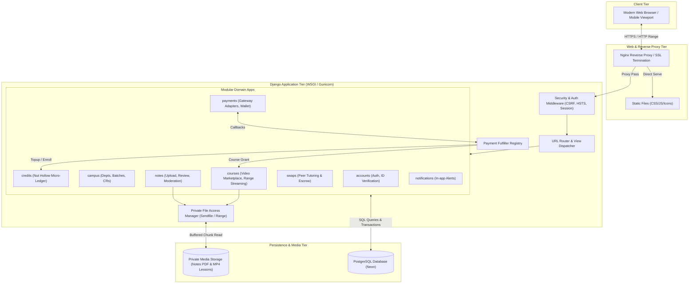
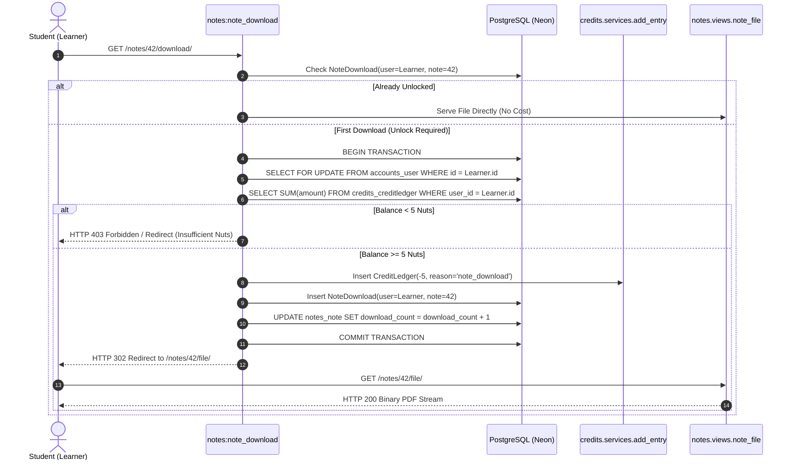
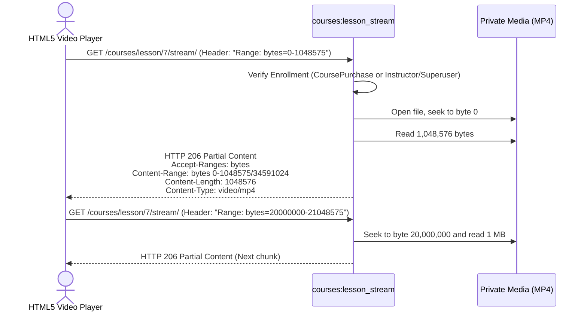
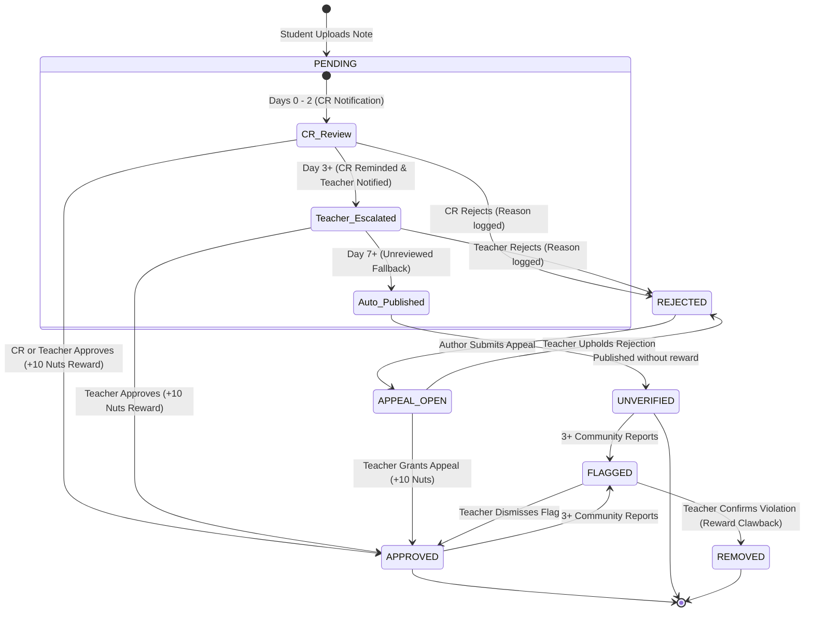
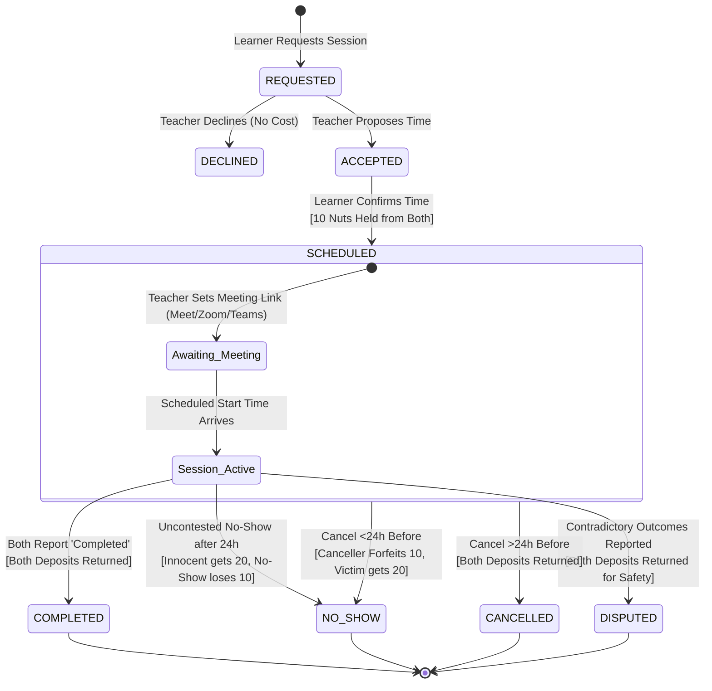

# Gayn Kotor — System Architecture

## 1. Architectural Overview & Design Principles

**Gayn Kotor** is an institutional campus knowledge-sharing and peer-learning platform built with a modular, decoupled architecture using **Django 6.1**, **PostgreSQL** (Neon Serverless), and modern frontend utilities (**Tailwind CSS**).

The architecture prioritizes:
- **Zero-Trust File Protection**: No academic notes or video files are directly accessible via public web server roots. Every byte served is verified against authenticated session permissions and access control policies.
- **Append-Only Financial Integrity**: Both the gamified internal micro-credit ledger (**Nut Hollow**) and the instructor real-currency wallet ledger (**Wallet**) are strictly immutable, append-only ledgers. Balances are derived from cryptographic-like ledger sums, and writes enforce row-level database locks (`SELECT ... FOR UPDATE`) to prevent double-spending.
- **Pluggable Payment Processing**: The payment infrastructure separates business domain logic (Credits, Courses) from payment collection via an in-memory fulfiller registry and gateway adapters.
- **Decentralized Hierarchical Moderation**: Peer moderation starts with student Class Representatives (CRs) and automatically escalates to faculty Class Teachers before applying deterministic fallback actions.



---

## 2. Modular Decoupling & App Responsibilities

To avoid circular dependencies and ensure strict maintainability, the codebase is segregated into 8 isolated Django apps:

| App | Core Responsibility | Key Invariants & Dependencies |
| :--- | :--- | :--- |
| **`accounts`** | Custom user model, 15-17 digit academic ID validation, signed email verification tokens. | Depends on nothing; foundational auth provider. |
| **`campus`** | Institutional hierarchy: Departments, Batches, Class Teachers, and CR Batch Memberships. | Depends only on `accounts`. |
| **`notes`** | PDF note submissions, PyMuPDF cover-page generation, view permissions, reporting, appeals. | Uses `campus` for batch routing, `credits` for rewards, and `notifications`. |
| **`credits`** | The **Nut Hollow** micro-credit ledger. Manages nuts economy, ledger transactions, and balance calculation. | Does not import `payments` or `courses`. |
| **`swaps`** | Peer-to-peer skill swap exchange. Enforces a 10-nut deposit escrow state machine and meeting link validation. | Depends on `credits` for deposit holding/forfeiture. |
| **`payments`** | Multi-gateway payment adapter (Sandbox, bKash, Nagad, SSLCommerz), PaymentOrders, instructor Wallet and Withdrawals. | Decoupled from `credits` and `courses` via `fulfiller_registry`. |
| **`courses`** | Video marketplace, mutagen duration validation, billable price limits, and HTTP Range partial streaming. | Gated behind `ENABLE_VIDEO_COURSES`. Registers fulfiller in `payments`. |
| **`notifications`** | Generic notification engine delivering user alerts and navbar badges. | Referenced by domain apps to notify actors. |

---

## 3. Nut Hollow Micro-Credit Ledger Architecture

The internal gamified economy uses **Nuts** as micro-credits. 

### Invariants:
1. **Append-Only Immutability**: Ledger entries are never updated or deleted. Corrective adjustments are recorded as new rows linked through the `reverses` foreign key.
2. **Double-Spend Protection**: Any operation subtracting credits (`amount < 0`) runs inside `@transaction.atomic`, acquires an exclusive database row lock on the user (`User.objects.select_for_update().get(pk=user.pk)`), and checks solvency before inserting the debit record.
3. **Per-Request Context Caching**: `get_balance(user, request=request)` caches the computed `SUM(amount)` on the `request` object during template rendering. Calling `add_entry` invalidates this cached value immediately.



---

## 4. Payment Fulfiller Registry & Wallet Architecture

To prevent tight coupling between financial payments and product delivery, `payments` uses a runtime **Fulfiller Registry**:

```python
# payments/registry.py
_FULFILLERS = {}

def register_fulfiller(purpose: str, fulfiller_fn: Callable):
    _FULFILLERS[purpose] = fulfiller_fn

def get_fulfiller(purpose: str) -> Optional[Callable]:
    return _FULFILLERS.get(purpose)
```

1. When `credits` boots, `CreditsConfig.ready()` registers `fulfill_credit_topup` for `PaymentOrder.Purpose.CREDIT_TOPUP`.
2. When `courses` boots, `CoursesConfig.ready()` registers `fulfill_course_purchase` for `PaymentOrder.Purpose.COURSE`.
3. When any payment gateway marks an order as paid, `payments.services.fulfil_order()` looks up the fulfiller and invokes it with `order`.

### Creator Wallet & Cash Withdrawals
- Every paid course sale splits the payment: **10% platform commission** and **90% instructor earnings**.
- Instructor earnings are appended to `WalletEntry` (`reason='course_sale'`).
- When an instructor requests a cash withdrawal (`payments:withdrawals`):
  1. The user's `Wallet` row is locked using `select_for_update()`.
  2. The wallet balance `SUM(amount)` is verified against `WITHDRAW_MIN_BDT` (default 500 BDT).
  3. A negative `WalletEntry` with `reason='withdrawal_hold'` is written immediately in the same transaction.
  4. A `WithdrawalRequest` is created in `PENDING` state.
  5. Upon admin payment, the request transitions to `PAID`. If rejected, a reversing positive `WalletEntry` (`withdrawal_reversal`) is written.

---

## 5. Private Storage & HTTP Range Streaming

### Private Notes Storage
PDF files uploaded by students are saved under `PRIVATE_MEDIA_ROOT` (e.g. `private_media/notes/`). Public web servers are instructed not to serve this directory directly. When an authorized user requests the file, Django streams the file chunk by chunk (or issues an `X-Accel-Redirect` / `X-Sendfile` header when supported by the web server).

### Video Course HTTP Range Streaming (RFC 7233)
Video playback requires instantaneous seeking and scrubbing without downloading full MP4 files upfront.
`courses.views.lesson_stream` implements a standards-compliant HTTP Range parser:



---

## 6. Note Review Escalation Engine

Notes uploaded by students are held in `PENDING` status. The review queue implements a decentralized escalation lifecycle:



---

## 7. Skill Swap Escrow & Deposit State Machine

The **swaps** engine implements an escrow state machine to protect peer-to-peer commitments.



---

## 8. Web Security & IDOR Defense Matrix

The application implements zero-trust defense against Insecure Direct Object References (IDOR), cross-site scripting (XSS), and cross-site request forgery (CSRF):

1. **Anti-Enumeration 404 Responses**: Unauthorized attempts to inspect unapproved, rejected, or private notes return `HTTP 404 Not Found` rather than `403 Forbidden` to prevent private identifier probing.
2. **Strict Object-Level Permissions**: Every view fetching models with primary keys verifies authorization against `request.user`:
   - Notes: visible only if approved, owned, or user holds a review seat in the author's batch.
   - Orders: visible only to order owner or superuser.
   - Video Streaming: requires confirmed `CoursePurchase` record or instructor ownership.
   - Swap Meeting Links: hidden until session status is `SCHEDULED`.
   - Withdrawal Requests: viewable and creatable only by wallet owner.
3. **Production Hardening**:
   - `SESSION_COOKIE_SECURE = True`, `CSRF_COOKIE_SECURE = True`, `SESSION_COOKIE_HTTPONLY = True`.
   - `SECURE_HSTS_SECONDS = 31536000`, `SECURE_HSTS_INCLUDE_SUBDOMAINS = True`, `SECURE_HSTS_PRELOAD = True`.
   - `SECURE_CONTENT_TYPE_NOSNIFF = True`, `X_FRAME_OPTIONS = "DENY"`.
