# Gayn Kotor — Entity-Relationship Diagram (ERD)

This document describes the complete relational data model of **Gayn Kotor**, implemented using Django 6.1 and PostgreSQL (Neon serverless).

## Relational Architecture Overview

The system models academic hierarchies, an immutable micro-credit ledger, a peer skill-swapping escrow engine, and an online video course marketplace.

```mermaid
erDiagram
    %% Accounts App
    USER ||--o{ BATCH_MEMBERSHIP : "has"
    USER ||--o{ NOTE : "authors"
    USER ||--o{ NOTE_DOWNLOAD : "downloads"
    USER ||--o{ NOTE_RATING : "rates"
    USER ||--o{ NOTE_REPORT : "reports"
    USER ||--o{ NOTE_APPEAL : "appeals"
    USER ||--o{ CREDIT_LEDGER : "owns balance entries"
    USER ||--o{ SKILL_POST : "publishes"
    USER ||--o{ SWAP_SESSION : "teaches/learns"
    USER ||--o{ SESSION_RATING : "submits"
    USER ||--o{ PAYMENT_ORDER : "places"
    USER ||--o| WALLET : "owns"
    USER ||--o{ WALLET_ENTRY : "earns/withdraws"
    USER ||--o{ WITHDRAWAL_REQUEST : "requests"
    USER ||--o{ COURSE : "instructs"
    USER ||--o{ COURSE_PURCHASE : "enrolled in"
    USER ||--o{ NOTIFICATION : "receives"

    %% Campus Hierarchy
    DEPARTMENT ||--o{ BATCH : "contains"
    BATCH ||--o{ BATCH_MEMBERSHIP : "enrolls"
    USER ||--o{ BATCH : "mentors as class teacher"

    %% Notes App
    DEPARTMENT ||--o{ NOTE : "categorizes"
    BATCH ||--o{ NOTE : "scopes"
    NOTE ||--o{ NOTE_DOWNLOAD : "tracks"
    NOTE ||--o{ NOTE_RATING : "evaluates"
    NOTE ||--o{ NOTE_REPORT : "flags"
    NOTE ||--o{ NOTE_APPEAL : "appeals rejection"

    %% Swaps App
    SKILL_POST ||--o{ SWAP_SESSION : "initiates"
    SWAP_SESSION ||--o{ SESSION_RATING : "reviews"

    %% Courses App
    COURSE ||--o{ LESSON : "contains"
    COURSE ||--o{ COURSE_PURCHASE : "sells"
    PRICING_RULE ||--o{ COURSE : "regulates category"

    %% Entity Definitions

    USER {
        bigint id PK
        string username UK
        string email UK
        string role "student | lecturer"
        string id_number UK "15-17 digit academic ID"
        boolean is_email_verified
        datetime email_verified_at
        datetime suspended_at
        string suspension_reason
        boolean is_staff
        boolean is_superuser
    }

    DEPARTMENT {
        bigint id PK
        string code UK "e.g. CSE"
        string name
        datetime created_at
    }

    BATCH {
        bigint id PK
        bigint department_id FK
        string name "e.g. Batch 2024"
        bigint class_teacher_id FK
        datetime created_at
    }

    BATCH_MEMBERSHIP {
        bigint id PK
        bigint user_id FK, UK
        bigint batch_id FK
        boolean is_cr "Class Representative"
        string status "pending | approved | rejected"
        datetime joined_at
    }

    NOTE {
        bigint id PK
        bigint owner_id FK
        bigint department_id FK
        bigint batch_id FK
        string title
        string course_code
        integer semester
        string file "Protected Private Storage"
        string preview_file "Cover page image"
        string status "pending | approved | unverified | rejected | removed | flagged"
        string visibility "public | department | batch"
        boolean reward_paid "10 Nuts initial bonus paid flag"
        bigint reviewed_by_id FK
        text rejection_reason
        datetime cr_reminded_at
        datetime escalated_at
        datetime published_at
        integer download_count
        datetime created_at
    }

    NOTE_DOWNLOAD {
        bigint id PK
        bigint user_id FK
        bigint note_id FK
        datetime downloaded_at
    }

    NOTE_RATING {
        bigint id PK
        bigint user_id FK
        bigint note_id FK
        integer rating "1 to 5"
        text review
        boolean owner_rewarded
        datetime created_at
    }

    NOTE_REPORT {
        bigint id PK
        bigint user_id FK
        bigint note_id FK
        string reason "copyright | inappropriate | wrong_course | spam | other"
        text details
        datetime created_at
        datetime resolved_at
        bigint resolved_by_id FK
    }

    NOTE_APPEAL {
        bigint id PK
        bigint note_id FK
        bigint user_id FK
        text message
        string status "open | upheld | granted"
        datetime decided_at
        bigint decided_by_id FK
        text decision_note
        datetime created_at
    }

    CREDIT_LEDGER {
        bigint id PK
        bigint user_id FK
        integer amount "Signed delta (+/- Nuts)"
        string reason "signup_bonus | note_upload | note_download | rating_received | rating_given | purchase | swap_hold | swap_return | swap_forfeit | admin | reversal"
        string description
        bigint reverses_id FK, UK "Nullable link to original entry"
        datetime created_at
    }

    SKILL_POST {
        bigint id PK
        bigint user_id FK
        string kind "offer | request"
        string skill_name
        text description
        boolean is_active
        datetime created_at
    }

    SWAP_SESSION {
        bigint id PK
        bigint post_id FK
        bigint teacher_id FK
        bigint learner_id FK
        string skill_name
        string status "requested | accepted | declined | scheduled | completed | cancelled | no_show | disputed | expired"
        datetime proposed_time
        string meeting_link "Google Meet | Zoom | Teams"
        boolean deposit_held "True when 10 nuts locked from each"
        string teacher_outcome "completed | no_show"
        datetime teacher_outcome_at
        string learner_outcome "completed | no_show"
        datetime learner_outcome_at
        datetime created_at
        datetime updated_at
    }

    SESSION_RATING {
        bigint id PK
        bigint session_id FK
        bigint rater_id FK
        bigint ratee_id FK
        integer score "1 to 5"
        text feedback
        datetime created_at
    }

    PAYMENT_ORDER {
        uuid id PK
        bigint user_id FK
        string purpose "credit_topup | course"
        decimal amount_bdt "10,2 digits"
        string status "created | pending | paid | failed | cancelled"
        string gateway "sandbox | bkash | nagad | sslcommerz"
        string gateway_txn_id
        string reference_type
        string reference_id
        datetime paid_at
        datetime created_at
    }

    WALLET {
        bigint id PK
        bigint user_id FK, UK
        datetime created_at
        datetime updated_at
    }

    WALLET_ENTRY {
        bigint id PK
        bigint user_id FK
        decimal amount "Signed delta (+/- BDT)"
        string reason "course_sale | withdrawal_hold | withdrawal_reversal | adjustment"
        string reference "e.g. order:UUID:course:ID"
        datetime created_at
    }

    WITHDRAWAL_REQUEST {
        bigint id PK
        bigint user_id FK
        decimal amount "BDT >= WITHDRAW_MIN_BDT"
        string method "bkash | nagad | rocket | bank"
        string account_details
        string status "pending | paid | rejected"
        text admin_note
        datetime created_at
        datetime decided_at
    }

    PRICING_RULE {
        bigint id PK
        string category UK "academic | non_academic"
        decimal min_per_hour
        decimal max_per_hour
        datetime updated_at
    }

    COURSE {
        bigint id PK
        bigint instructor_id FK
        string title
        text description
        string category "academic | non_academic"
        decimal price "BDT (constrained by duration & PricingRule)"
        string status "draft | published | archived"
        integer total_duration_seconds
        datetime created_at
        datetime updated_at
    }

    LESSON {
        bigint id PK
        bigint course_id FK
        string title
        integer order
        integer duration_seconds
        boolean is_free_preview
        string video_file "Protected MP4 storage"
        string external_video_url
        datetime created_at
    }

    COURSE_PURCHASE {
        bigint id PK
        bigint user_id FK
        bigint course_id FK
        decimal amount_paid
        decimal commission_amount "10% Platform share"
        decimal seller_earning "90% Instructor share"
        string transaction_id
        boolean is_successful
        datetime purchased_at
    }

    NOTIFICATION {
        bigint id PK
        bigint user_id FK
        string text
        string link
        boolean is_read
        datetime created_at
    }
```

## Key Invariants & Database Integrity Rules

1. **Append-Only Credit Ledger**: The `CREDIT_LEDGER` table has no `UPDATE` or `DELETE` triggers. Balances are calculated dynamically as `SUM(amount)`. Negative mutations lock the `User` row (`SELECT ... FOR UPDATE`) to eliminate double-spend race conditions.
2. **Double-Spend Prevention in Escrow**: `SWAP_SESSION` holds 10 nuts each from teacher and learner upon scheduling. The deposits are atomically released upon confirmed mutual completion, or forfeited upon verified no-show.
3. **Double-Spend Prevention in Cash Withdrawals**: `WITHDRAWAL_REQUEST` creation locks the user's `WALLET` row, verifies `SUM(amount) >= withdrawal_amount`, and immediately inserts a negative `WITHDRAWAL_HOLD` entry to guarantee instructor solvency.
4. **Content Protection & Isolation**: Note PDF binaries and course video MP4 files are stored in `PRIVATE_MEDIA_ROOT` outside web-accessible document roots, served only through authenticated Django views with permission checks and HTTP Range streaming.
